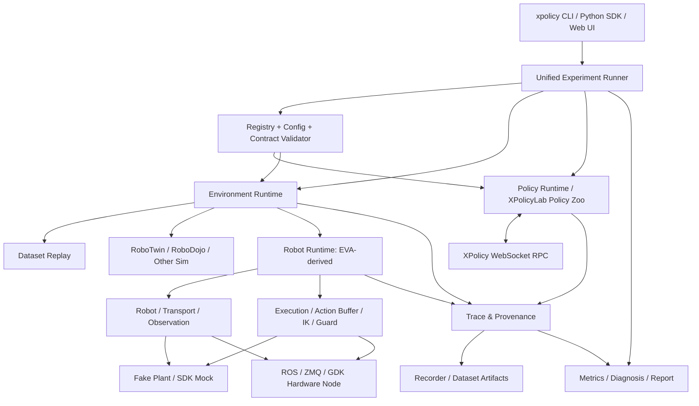
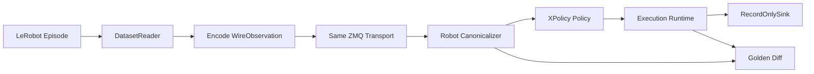
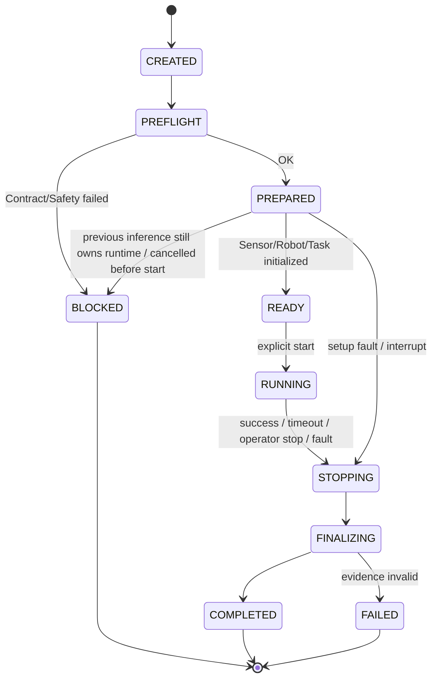
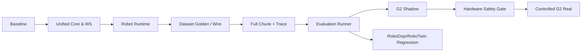

# XPolicyLab Unified v4 — 通用机器人学习、部署与统一评估平台

**版本**：v4.2 / 2026-10-14（依据实施证据持续修订）\
**定位**：全新开源工程架构蓝图（基于 XPolicyLab 与 EVA-CLIENT 的成熟实现融合升级）\
**文档状态**：设计、验收规范及实施修订记录；**完整系统尚未验收**。目标目录和设计示例不等于已实现接口；实际可运行命令与证据范围以仓库 `docs/migration-status.md` 和对应运行报告为准。\
**上游基础**：[XPolicyLab](https://github.com/XPolicyLab/XPolicyLab)（Apache-2.0）、[EVA-CLIENT](https://github.com/Noietch/EVA-CLIENT)（Apache-2.0）。第三方模型、SDK、权重、URDF/网格资源需单独审查授权和再分发条款。\
**演进关系**：v1/v2/v3 偏向“以 XPolicyLab 调用独立 EVA”；**v4 正式取消两套框架长期并行的目标**，建立**一个代码仓库、一套公共数据语义、一套评估生命周期、一套实验结果、一套诊断体系**；保留按实际任务拆分进程和依赖环境的能力。

---

## 0. 决策摘要：全新工程，不做双框架桥接

### 0.1 关键决定

1. **在当前仓库演进公共核心**：当前实现继续使用 `robot-feng/XPolicyLab`，保留原项目署名和兼容入口，Python distribution 为 `xpolicylab`，新导入路径与 CLI 为 `xpolicy`。不为统一设计额外建立一个长期并行仓库；公开发布前仍需核对命名和授权。与上游没有官方隶属关系时，不应冒称官方升级版。
2. **Policy 以 XPolicyLab 为底座**：政策注册、模型加载、服务端、已有 RoboTwin/RoboDojo 集成优先迁入/保留，避免 63 个策略逐个重做。
3. **Robot/Transport/Execution 以 EVA 为底座**：迁入 Robot Zoo、ROS/ZMQ、IK/FK、动作缓存、异步控制、录制、硬件节点和真机调试能力；重用已测试行为，逐步理顺其大型 `core.app` 运行流程。
4. **Environment 同一抽象，运行模式不同**：`dataset`, `sim`, `fake`, `sdk_mock`, `shadow`, `real` 统一交给一个 Runner；但不假设这些环境有完全相同的实时能力与因果反馈。
5. **以训练时实际模型输入与动作含义为准**：`Training Runtime Contract` 由 checkpoint 配置、真实 DataLoader 样本、训练统计量和 Robot Profile 共同形成。数据集、仿真、真机在**进入 policy 的公共边界**对齐；模型专属 resize/crop/normalization 仍归模型模块。
6. **Action Chunk 只有一个消费端**：Policy 负责预测与必要的模型空间反归一化，Execution 负责 chunk 消费、调度、融合和控制；禁止模型适配器和 EVA 同时裁剪/滚动同一个 chunk。
7. **明确统一依赖，不制造人为隔离**：公共运行库合并依赖（包括 WebSocket 版本）；硬件厂商 SDK、Isaac/ROS、各 VLA 的 CUDA/深度学习环境按确实存在的二进制/系统兼容性进行可选隔离。*单一项目 != 所有进程强制共用一个 Python 解释器*。
8. **诊断与验收作为一等功能**：任何支持真机的 Robot Profile，必须能运行数据集对照、SDK Mock、Shadow，以及动作—设备—反馈追踪；不能只把“模型能给出动作”定义为部署成功。

### 0.2 v3 → v4 重大变化

| 维度 | v3（双仓库集成） | v4（统一系统） |
|---|---|---|
| 源码 | XPL 和 EVA 独立仓库、单独发布 shared contracts | **一个主仓库**，一个公共核心实现，按 `extras`/进程进行功能划分 |
| 协议 | EVA 额外实现 XPL PolicyClient 并长期桥接 | XPL WebSocket 是**唯一内部 Policy RPC**；旧 EVA/OpenPI 直连客户端转 legacy 可选兼容层，不再占主流程 |
| 配置 | 两套配置兼容、跨仓库转换 | 单一配置系统 `policy/robot/environment/execution/evaluation`，一次校验 |
| 实验生命周期 | Runner 通过 EVA Control Channel 间接驱动 EVA EVAL | 单一 `ExperimentRunner` 驱动统一 Runtime；真机命令仍由本地 Robot Service 安全执行 |
| Recorder | EVA 记录、XPL 再汇总 | 单一 Episode/Trace 元数据模型；复用 EVA 的原始数据写入能力 |
| 数据集模式 | 单独 DatasetWireNode + Bridge | 同一 Environment Registry 内 `DatasetEnvironment`，需要“硬件仿真”时复用统一 Wire Adapter |
| 安全 | 远端 Guard + 设备 Guard | **设备安全域为唯一最后防线**，拥有独立权限，不能因软件合并被绕过 |
| 版本冲突 | 视为分环境动机 | 迁入时统一改代码与依赖，跑 compatibility test，只有客观必要的运行环境才隔离 |
| 项目升级 | 两仓库补丁 | 基于源码迁移、回归确认、按能力逐步启用；未来不依赖原项目持续存在 |

### 0.3 不能省略的物理事实

- 同一数据结构 ≠ 同一训练分布；相机视角、夹爪结构、任务布置、动力学仍影响成功率。
- 14D ARX X5 动作不能凭“映射到 24D G2”自动实现跨本体泛化；只有**语义对应且经过数据/模型验证**的 action subset 才能执行。
- 数据集播放下一帧不依赖当前动作，**不是物理闭环**。它检验编码、逻辑与数值一致性；任务闭环需 Fake Plant 或仿真/真实物理环境。
- 真实动作可以在一套源码中发起，但实时控制与安全停止仍必须以本地设备状态为准，不能靠网络 RPC 心跳保证安全。

---

### 0.4 实施修订原则（2026-10-14）

- **按实测修订设计**：蓝图允许在实现过程中调整；保留原始目标、差异原因、实现路径和验收证据。当前实施记录见 `docs/migration-status.md`，模型黄金样本见 `docs/training-golden.md`。
- **当前授权边界**：EVA 部分暂缓更新。因此实际 EVA WireObservation/ZMQ、Fake G2、GDK/ROS/SDK 与现场验收仍保留为后续工作，不能用新写的普通 ZMQ 编解码器或无关 FakePlant 替代其验收。
- **Conda + uv 混合管理**：复用已有 Conda Python/PyTorch/CUDA，使用 `pyproject.toml` 管理 Python 包依赖；清洁 CPU 核心环境另用公共 `uv.lock` 验证。已有模型环境的依赖冲突必须保留证据，不能将核心 CPU PASS 宣称为全环境兼容。
- **O2 分层取证**：真实 loader 打包的图片和 state、VLM 的 token/pixel/grid 输入、action head 最终接收的 state tensor 分别记录。图片 resize 一致不等于最终模型输入一致；原始 state 的 dtype、归一化运算 dtype、loader 打包 dtype、模型计算 dtype 均影响结果。
- **精度需要显式配置**：当前 G2 loader 使用 float64 原始 state 进行归一化，再打包为 float16；直接走 float32 会在实际黄金样本中造成差异。`state_input_dtype` 与 `model_state_dtype` 必须从实际训练路径选择并通过握手核对，不从 action/state 维数猜测。
- **声明实际返回的 chunk**：RollingFlow 样例 checkpoint 的规划 horizon 是 64，模型公开预测入口返回的 execution chunk 是 16。Policy contract 必须声明实际返回的完整 `[T,D]`，同时记录内部规划 horizon；禁止补零凑到 64，也禁止由两个消费端重复裁剪。
- **模型诊断与设备支持分别验收**：使用真实 G2 registry、统计量、checkpoint 和 XPL 归一化 wrapper 的模型侧组合可证明数值边界；它仍不是完整的 24D G2 runtime 注册。head/waist、inner/outer gripper、单位、在线 measured feedback 和 SDK 映射必须另有证据。
- **生命周期和任务结果分别记录**：当前实现共用 `ExperimentRunner`/trial 状态机，offline READY 表示录制数据游标与 model episode context 已就绪；不表示机器人/物体场景复位。host stop 不等于设备 ACK。`TaskSpec` 可约束 instruction、允许动作类型、有效超时和证据；dataset 仍拒绝将标签或回放完成判为当前 policy 的任务成功。
- **汇总从证据与原始样本出发**：结果 schema 2 保留 trial transition、首次 stop reason、未开始 repeats 与文件哈希。`xpolicy results summarize` 校验结果与 trial_end trace，按条件/评判来源分组，合并原始延迟样本而非平均 p95；未评判时成功率为 null，FAIL/BLOCKED 不被健康运行覆盖。实际跨模式 provider、场景复位和现场分数仍待验收。

---

## 1. 产品目标与非目标

### 1.1 目标用户与场景

- 算法研发：一个模型既能训练、离线回放，又能在多模拟器/真实机器人评测。
- 机器人集成：增加新机器人仅需一个 Robot Profile、Transport/Driver 和少量必要的映射；现有模型按兼容性筛选。
- 基准评测：统一重复次数、任务定义、随机种子、记录、任务成功与失败归因。
- 真实实验调试：能看见 `Dataset → Policy → Chunk → Execution → Device Request → Measured Feedback` 每一个分叉点。
- 部署排障：针对 AgiBot G2 当前“动作一直不对”优先实现可复现、可定位的异常诊断。

### 1.2 非目标（v4 初期明确不做）

- 不重写 RoboTwin/RoboDojo 的物理引擎、场景和奖励。
- 不从零重写 EVA 的 ROS/ZMQ、Robot Zoo、录制器及同步/异步策略。
- 不立即迁移所有模型训练器到统一训练 API；初期统一调用外部/原有训练脚本，逐步建立模型工件 manifest。
- 不将 Isaac、ROS1、ROS2、GDK、全部 VLA 权重依赖安装在一个环境中；只统一公共 Python 栈与数据/操作接口。
- 不声称一个策略 checkpoint 无需适配就能控制任意本体。
- 不以第三方 Isaac/ROS/GDK 软件安全机制替代现场急停/人员操作制度。

### 1.3 可检验的完成定义（Definition of Done）

1. 原 XPL 的一个基线策略可在原 RoboDojo 环境跑出与迁移前**相同输入/seed 条件**下可解释、回归可接受的结果。
2. 同一统一 CLI 能进行 dataset direct、dataset wire、EVA Fake G2、指定仿真基准、G2 shadow，并统一生成 evidence。
3. 一段黄金训练样本通过 dataset direct 与 dataset wire 得到**同一 policy 边界数值（按明确容差）**及同一动作解释。
4. 给定一个冻结的 raw action，设备适配器输出与机器人厂商 API 期望的关节/单位顺序一致，并具备静态/动态不变量检查。
5. 能在 G2 SDK Mock 看到同一个 trace ID 的 input、prediction、buffer、wire、SDK 命令、反馈。
6. 合规安全测试通过后才能启用 `real` 模式；Shadow 必须能证明没有发出任何真实伺服调用。
7. CI 默认无 GPU、无机器人也能运行公共包、golden dataset、协议和 Fake 测试；缺失依赖时标记 SKIP/BLOCKED，不虚报 PASS。

---

## 2. 总体系统架构



**纵向三层：**

- **Research & Evaluation Control Plane**：配置、实验、模型实例、任务复位、结果。
- **Policy & Environment Data Plane**：统一观测，模型预测完整动作块；数据集、仿真或设备响应。
- **Device Safety Plane**：仅实际硬件具有物理控制权限；本地 watchdog、驱动状态与急停接口绝不由远程模型强行绕过。

**横向一条诊断链：** 输入原始样本 → canonical input → policy input → prediction → executor decision → device command → feedback → next observation，全部基于同一个实验标识与数据契约追溯。

### 2.1 单仓库不等于单进程

建议统一项目同时支持：

- `local`：dataset/mock/CPU tests 使用同一个 Python 环境、单进程直接调用对象；最快诊断路径。
- `split`：模型使用 GPU Policy Server 进程；Runner 和 Robot Runtime 是另一个进程；不改变 Python API。
- `distributed`：服务器和机器人不同机器，统一 Policy RPC；设备安全本地保留。网络断开不得自动恢复真实运动。

网络协议只是进程间通信实现，不是第二套业务架构。典型节点：`xpolicy eval` 负责调度、`xpolicy policy serve` 负责推理、`xpolicy robot serve` 负责传感器/动作执行，硬件 SDK Node 可以按供应商需求独立进程。

### 2.2 核心模块唯一所有者

| 资源/职责 | 所有者 | 不允许的重复实现 |
|---|---|---|
| 模型加载、训练统计量、模型预处理 | `policy` | Robot Runtime 二次做策略归一化 / resize |
| 底层传感器、真实关节原始格式 | `robots/drivers` | Policy Adapter 推测设备关节排列 |
| 统一边界 Observation/Action | `core/contracts` | 仿真和真机各定义一套互不兼容协议 |
| Chunk 调度/异步融合/执行节拍 | `execution` | Policy 与 Execution 两边重复滚动缓存 |
| 机器人 FK/IK 与状态映射 | `robots` | 每个模型单独写 IK/关节顺序 |
| 真实硬件许可/限位/失联保护 | 本地 `safety + driver` | 模型超时后继续执行旧动作 |
| 任务生命周期 / Trial ID | `evaluation` | EVA Console 自行重新编号评测 |
| 原始录制 / 溯源 Trace | `recording/diagnostics` | 临时 print 取代机器可读证据 |
| 报告 / 指标 | `evaluation/metrics` | 仿真一套、真机一套成功率定义 |

---

## 3. 推荐工程目录与代码迁移边界

**原则：目标结构清晰，迁移阶段不急着大规模移动原始代码。** 先让现有模块在新仓库中按原行为工作，再逐步稳定 API，避免一次重命名几十个文件造成回归故障。

```text
XPolicyLab-Unified/
├── pyproject.toml                    # 一份主项目/公共依赖规范
├── uv.lock                           # 主运行栈锁；不强制替代模型/SDK专用锁
├── LICENSE
├── NOTICE                            # 两上游署名、第三方许可清单
├── README.md
├── docs/
│   ├── architecture.md
│   ├── contracts.md
│   ├── developer-guide.md
│   ├── deployment.md
│   ├── evaluation.md
│   ├── diagnostics.md
│   ├── hardware-safety.md
│   └── migration-provenance.md
├── src/xpolicy/
│   ├── __init__.py
│   ├── cli.py                         # xpolicy ...
│   ├── core/
│   │   ├── contracts.py               # Observation / ActionChunk / RobotProfile / Timebase
│   │   ├── registry.py                # model, robot, environment, strategy
│   │   ├── config.py                  # 统一配置 + 组合验证
│   │   ├── lifecycle.py               # Episode state machine
│   │   ├── errors.py
│   │   └── artifacts.py
│   ├── policy/
│   │   ├── runtime.py                 # standard infer, checkpoint manifest
│   │   ├── adapters/                  # 移植原 XPolicyLab policy/*
│   │   ├── serving/                   # 原 XPL client_server/ws
│   │   └── training/                  # 原脚本的调用包装，不重写训练框架
│   ├── environments/
│   │   ├── base.py                    # lifecycle / status / capabilities
│   │   ├── dataset.py                 # direct and wire playback
│   │   ├── simulation/                # 原 XPL benchmark adapters
│   │   └── robots.py                  # EVA Robot Runtime adapter
│   ├── robots/
│   │   ├── base.py                    # EVA Robot / ActuatorGroup
│   │   ├── profiles/                  # robot profiles + strict mapping
│   │   ├── kinematics/                # EVA PyRoki and other IK/FK
│   │   ├── drivers/                   # G2/Franka/UR5e/... adapters
│   │   └── assets/                    # 审计后允许再分发的 URDF/mesh
│   ├── transport/
│   │   ├── base.py
│   │   ├── zmq.py                     # EVA legacy wire compatibility
│   │   ├── ros1.py
│   │   ├── ros2.py
│   │   ├── dataset.py                 # dataset decoder (not a second runner)
│   │   └── protocol_v2.py            # versioned ACK/seq/episode/TTL metadata
│   ├── execution/
│   │   ├── runtime.py                 # one owner of action execution
│   │   ├── strategy.py                # EVA async/sync/RTC
│   │   ├── action_buffer.py
│   │   ├── action_mapper.py
│   │   └── watchdog.py
│   ├── safety/
│   │   ├── limits.py
│   │   ├── admission.py
│   │   └── interlocks.py
│   ├── recording/
│   │   ├── episode.py                 # EVA recorder (迁移/复用)
│   │   ├── dataset_format.py
│   │   ├── evidence.py
│   │   └── trace.py
│   ├── evaluation/
│   │   ├── runner.py
│   │   ├── task.py
│   │   ├── status.py
│   │   ├── metrics.py
│   │   └── reports.py
│   ├── diagnostics/
│   │   ├── doctor.py
│   │   ├── golden.py
│   │   ├── diff.py
│   │   ├── injector.py
│   │   └── html_report.py
│   └── ui/                          # 初期复用 EVA Console，后续统一
├── configs/
│   ├── policies/
│   ├── robots/
│   ├── tasks/
│   ├── environments/
│   ├── executions/
│   └── experiments/
├── examples/
│   ├── datasets/
│   ├── simulation/
│   └── real_robots/
│       └── agibot_g2/
│           ├── node.py
│           ├── fake_node.py
│           ├── sdk_mock.py
│           ├── profile.yaml
│           ├── README.md
│           └── diagnostics/
├── tests/
│   ├── unit/
│   ├── contracts/
│   ├── policy/
│   ├── dataset/
│   ├── wire/
│   ├── fake/
│   ├── simulation/
│   ├── migration/
│   └── hardware/                  # 硬件在场才运行
├── tools/
│   ├── export_golden_samples.py
│   ├── inspect_checkpoint.py
│   └── migrate_eva_datasets.py
└── third_party/
    └── README.md                  # 权重/SDK 只保存安装说明，不非法复制
```

> 说明：目录是**稳定目标**而不是要求 PR-1 一次性全部建立。项目内部不强制把原 XPL 每个 `policy/<NAME>/` 直接搬到 `src/xpolicy/policy/adapters/`；可以先保留原目录并注册，逐步迁移包导入路径和文件结构。

### 3.1 上游代码迁移矩阵

| 原仓库与文件/模块 | 新模块目标 | 迁移方式 | 首轮验收 |
|---|---|---|---|
| XPL `model_template.py` | `policy/runtime.py` | 先兼容 API，扩展 chunk 能力 | 原策略无需修改即可推理 |
| XPL `client_server/ws/*` | `policy/serving/*` | 直接移植+必要的 import 修复 | RPC handshake/reset/infer/call/reconnect 一致 |
| XPL `policy/*` | `policy/adapters` / legacy 目录 | **逐个分批**，先 StarVLA、demo，再其它 | 已迁策略 checkpoint/输出回归 |
| XPL RoboDojo/RoboTwin 环境脚本 | `environments/simulation` | 以 wrapper 承载旧环境入口 | 原 benchmark 回归 |
| EVA `src/robots/*` | `robots/*` | 复用类和 kinematics | Robot Zoo 单测、G2 joint mapping |
| EVA `src/transport/*` | `transport/*` | 复用消息编码/ROS/ZMQ；补版本化元数据 | 同帧/同动作 wire roundtrip |
| EVA `src/strategy/*` | `execution/*` | 保留算法；唯一执行控制权 | async/generation/buffer 单测 |
| EVA `src/core/recorder/*` | `recording/*` | 保留数据写入逻辑 | LeRobot 文件有效与回放可读 |
| EVA `examples/hardware/*` | `examples/real_robots/*` | 引用上游保留版权信息，逐机器人迁移 | Fake/SDK Mock/只读真机 |
| EVA `core.app` 和 Console | `evaluation`/`ui` | 只迁必要部分，不整体复制两个 Runner | 一个 Episode ID、一份状态机 |
| EVA `policy_client/*` | 兼容层 `policy/legacy_clients` | 非必要接口暂留；主流程改统一 RPC | 默认不会绕过新策略路径 |

**迁移验收优先级**：行为回归 > 目录整洁 > 代码去重。对于 XPL 的大量 adapter，采用“保留原适配器 API + 新统一 runtime 外层包装”成本远低于重写。

---

## 4. 依赖统一和 WebSocket 冲突的实际处理

### 4.1 明确：可以统一 `websockets`，不需要两套框架

经核查：

- XPL `pyproject.toml`：`websockets>=14.0`；其 WebSocket Policy Server 使用 `websockets.asyncio.server`。
- EVA `pyproject.toml`：`websockets==13.1`；旧 `_ws.py` 使用 `websockets.sync.client.connect`；其原 StarVLA 客户端有单独协议封装。
- EVA 的很多策略客户端并非需要作为统一系统主路径：接入 XPL Policy Runtime 后，应优先调用**一种统一 XPolicy WebSocket RPC**，而不是同时维护 OpenPI-StarVLA-EVA-XPL 四套内部推理协议。

因此 v4 **不保留两个互相冲突的公共依赖版本**。建议公共依赖约束从 `websockets>=14,<16` 起进行验证（这是拟议兼容范围，**非已验证的版本选择**），经 CI 和实际安装验证后，在 `uv.lock` 固定最终确切版本。不要在文档中未经测试声称 13.1 → 14+ 一定无兼容问题。

### 4.2 统一依赖的实施步骤

1. 建立新的 `pyproject.toml`，公共包只依赖 numpy、pydantic、pyyaml、msgpack、websockets 等轻依赖。
2. 将 EVA `_ws.py` 的旧调用移入兼容测试环境，验证 `websockets.sync.client.connect` 在选定版本上的握手、发送、接收、超时、close 行为。**如果旧客户端不再作为默认路径，可不继续维护其所有历史兼容能力**。
3. XPL `client_server/ws` 在同一所选版本上测试 HELLO/INFER/CALL/RESET/TRIAL_END、图像编码/解码、断连重连、请求去重与服务器重启保护。
4. 通过 `uv lock`、`uv sync`、`uv pip check` / `pip check` 检查锁依赖和二进制安装；所有可选 extras 单独测试导入。
5. 训练服务器如需固定 CUDA、PyTorch、transformers、FlashAttention 版本，允许独立进程及 lock；这是**模型原生依赖隔离**，不是 XPL/EVA 两套上层框架。
6. 厂商 GDK、ROS、Isaac 也以 `extra` 或进程隔离；与公共 CLI 共享数据契约和测试标准。

### 4.3 建议 `pyproject.toml`（设计样例）

```toml
[project]
name = "xpolicy-unified"
version = "0.1.0"
requires-python = ">=3.11,<3.13"
dependencies = [
  "numpy>=1.26,<3",
  "pydantic>=2.5,<3",
  "pyyaml>=6,<7",
  "msgpack>=1.0.8,<2",
  "msgpack-numpy>=0.4.8,<1",
  "websockets>=14,<16",
]

[project.optional-dependencies]
recorder = ["pyarrow>=16", "av>=12", "opencv-python-headless>=4.8"]
zmq = ["pyzmq>=25"]
web = ["viser>=1.0"]
kinematics = ["trimesh>=4", "yourdfpy>=0.0.60"]
test = ["pytest>=8", "pytest-cov>=5"]

[project.scripts]
xpolicy = "xpolicy.cli:main"
```

约束说明：范围是**设计候选**，在真实硬件、模型和 benchmark 环境锁定后，需要按经过的兼容性矩阵收紧。这里并未把 JAX/PyRoki、Isaac/ROS、GDK 和深度学习模型的大包放进核心依赖。

### 4.4 按功能而非来源划分依赖

| 环境类别 | 安装用途 | 主张 |
|---|---|---|
| `core` | CLI / contracts / runner / WebSocket / mock | 一个轻量公共环境，直接统一版本 |
| `recorder`, `zmq`, `web` extras | 录像、ZMQ、UI | 公共工程可选依赖，不拆成第二个框架 |
| `robot-g2` / `robot-franka` | 对应 SDK、驱动依赖 | 能兼容则同环境；需要供应商约束时单独进程 |
| `policy-starvla` / `policy-pi0` | 对应模型和 GPU 栈 | 依据 CUDA / transformer 实际冲突选择进程环境 |
| `sim-robotwin` / `sim-robodojo` | 场景和物理引擎 | 保留原官方仿真依赖，不污染轻量主环境 |

**结论**：一个仓库、一个公共依赖解析方案、一份系统接口；必要时多个由**一个 CLI 编排**的运行进程，不再维护 XPL 和 EVA 两个产品生命周期。

---

## 5. 最关键：训练—数据集—真机的统一数据定义

### 5.1 强调“公共边界”，而不是强制训练数据文件相同

```
Checkpoint + Real Training DataLoader  ──────┐
                                              │ export & verify contract
Dataset Reader ───────┐                       ▼
Simulation Reader ────┼──► Canonical Observation ──► Policy Adapter
Real Sensor Reader ───┘                              │
                                                    ▼
                                     Policy-specific preprocessing
                                     (resize/crop/normalize/encode)
                                                    │
                                             Model inference
                                                    │
                                     Policy-specific unnormalization
                                                    │
                                           Canonical ActionChunk
                                                    │
                                         Unified Execution Runtime
                                                    │
                                      Dataset / Sim / Real Sink
```

**外部统一部分**：图像对应哪台相机、像素值代表 RGB 还是 BGR、是否实时/是否缺帧；机器人状态变量与关节排列、单位、参考系；动作代表关节绝对位置、增量、速度还是 EEF 目标；时间戳与步间隔。\
**内部模型部分**：每个 Policy Adapter 自己进行 resize、crop、padding、图像标准化、tokenization、state normalization、模型前向、必要的 action denormalization。\
**只保留一套实际转换实现**：一处 Canonicalizer + RobotProfile，不允许 dataset/sim/real 使用内容相同却彼此漂移的转换代码。

### 5.2 Observation 与 Action 的最小规范

```python
from dataclasses import dataclass, field
from typing import Literal
import numpy as np

@dataclass(frozen=True)
class Observation:
    images: dict[str, np.ndarray]           # HWC uint8; declared RGB/BGR in profile
    state: np.ndarray                       # order/units by robot profile
    instruction: str
    timestamp_s: float                      # source clock + explicit clock_domain
    frame_id: int
    meta: dict = field(default_factory=dict) # clock_domain, validity, profile_version

@dataclass(frozen=True)
class ActionChunk:
    values: np.ndarray                      # [T, D], physical units at boundary
    action_type: Literal[
        "joint_position", "joint_delta", "joint_velocity", "eef_pose"
    ]
    source_frame_id: int
    episode_id: str
    sequence_id: int
    meta: dict = field(default_factory=dict) # names/units/horizon/validity/TTL
```

这是公共边界的语义示例，不要求运行时每个对象都复制全量图像到新内存。可用不可变引用、内存池、共享内存降低复制，但必须保证录制与消费无数据竞争。生产版本建议将 `clock_domain`, `joint_names`, `color_space`, `action_units` 提升为强类型字段或通过强类型 Profile 关联；`meta` 不可成为绕开契约校验的自由字段。

### 5.3 ModelManifest、RobotProfile、DatasetProfile（三个有各自含义的描述文件）

| 文件 | 声明什么 | 来源 |
|---|---|---|
| `ModelManifest` | checkpoint SHA、期望模态、是否用 state、训练 state/action 语义、预测 horizon、统计量与 DataLoader 版本 | 真实训练工件与 golden fixture |
| `RobotProfile` | 摄像头设备键、逻辑观测名、具名关节排列、极限、执行率、夹爪几何/方向、坐标系、driver capabilities | Robot Zoo + 真实 SDK 核查 |
| `DatasetProfile` | 存储版本、字段路径、相机视频 key、时间轴、状态维度、动作含义、来源本体及录制单位 | 数据集实际字段和采集元数据 |

中央 `ContractValidator` 以三者**交叉验证**。同一模型可能服务多个 robot profile，但必须有明确的 compatibility declaration，不能用 `dim == dim` 代替“物理语义相同”。

### 5.4 训练样本 Golden Fixture

必须从实际训练 DataLoader 中导出小型、可追溯样本：

- checkpoint / loader SHA、原始 dataset id、episode/frame/timestamp；
- **模型前的公共边界**：相机列表、图像数组或其哈希、state 数值与具名字段；
- **进入模型前的 loader 输出**：经过模型专属预处理的 image tensor 和 state tensor；
- action target、normalization stats、夹爪映射与 action type；
- 模型在 eval 固定种子下的原始预测（适用于可确定性推理的 checkpoint）；
- tolerance 定义和可能的 JPEG/视频解码误差上限；
- 不允许将训练集动作标签误当作逐帧策略 prediction 的确定性真值。

从这里建立两条不同的测试：

- **公共边界数值测试**：same raw frame -> direct dataset 和 dataset-via-wire 的 canonical Observation 相同（无损才要求 bitwise；有损视频按预设容差）。
- **模型内部预处理测试**：同一 canonical Observation → 真训练 loader 与新 Policy Adapter 在最终 tensor 层对齐（需确认训练增强是否关闭或固定随机性）；这项是用户所说“模型训练见到的一样”的严格依据。

### 5.5 不可接受的静默行为

在 strict deploy/test 模式下禁止：

- 缺摄像头使用黑帧代替而不报错：EVA 原 `DatasetTransport` 有此 fallback；需切换为明确 `MissingCamera`，仅录制预览允许显式 `allow_missing`。
- robot state 缺部分关节后自动截断/拼接/补初始姿态：原 `DatasetTransport._expand_robot_qpos` 会为 disabled groups 插入初始值，必须将之限定为**显式申明的 `inactive hold`**，禁止伪装真实测量。
- 隐式交换 RGB/BGR、CHW/HWC；Policy Adapter 可转内部布局，但公共边界必须可见与可验证。
- checkpoint normalized action 未反归一化直接交给设备；action_type 未指定时默认 `joint_position`。
- 通过不同 profile 使用相同 `state_dim` 偷换左右臂、夹爪或参考系。

---

## 6. 一套 Environment，六种可替换执行模式

| 模式 | Observation 来源 | Action 去向 | 是否为因果闭环 | 主要检查 |
|---|---|---|---|---|
| `dataset_direct` | Dataset decoder | RecordOnly | 否 | Dataset/Policy 数据契约与模型回归 |
| `dataset_wire` | Dataset → ZMQ fake hardware | RecordOnly | 否 | 实机同款 wire/Robot/Execution 代码路径 |
| `fake_plant` | EVA 二阶状态模拟器、合成相机 | Fake actuator | 部分：关节因果，图像不依动作 | 控制、关节跟踪、缓存和 reset |
| `sdk_mock` | 真实 `node.py` + mock GDK | mock servo | 关节回显或伪动力学 | 设备调用结构、关节名、SDK线程/频率 |
| `physics_sim` | MuJoCo/Isaac（可选） | Physics actuator | 是：取决于场景/模型 | 视觉—动作—物理交互 |
| `shadow` / `real` | 真机器人传感器 | Shadow: no servo / Real: hardware | Shadow 否；Real 是 | 真实相机/状态、驱动/控制与安全 |

`DatasetEnvironment` 为一个环境类但可选择 `source=direct|wire`；`RealRobotEnvironment` 使用同一 Robot Runtime，但 `armed` 属性受独立安全状态约束。`SimEnvironment` 对接现有 RoboTwin/RoboDojo，**不必让原仿真控制循环都迁成 EVA 的连续执行**；只统一契约、生命期、结果与可观测性，保留物理引擎适合的同步步进。这是高价值抽象而非强行同实现。

### 6.1 建议 Environment API：区分生命周期和采样语义

```python
class Environment:
    def capabilities(self) -> dict: ...
    def preflight(self, plan) -> None: ...
    def reset(self, task) -> None: ...
    def observe(self) -> Observation: ...
    def submit(self, action: ActionChunk) -> None: ...
    def poll(self) -> dict: ...
    def halt(self, reason: str) -> None: ...
    def finalize(self) -> dict: ...
    def close(self) -> None: ...
```

- `submit` 在同步模拟器可立即应用，在连续真机可提交给本地 Execution；实际是否执行成功必须查 `poll`/反馈，不得仅以 RPC accepted 当作硬件成功。
- Runner 不假定每一次 `observe` 都有下一帧；dataset 依靠已录数据推进，物理环境依靠实际反馈生成新观测。
- 开始 real 模式还需要 `arm` 门禁；它是设备安全许可，不是普通环境 `reset` 的副作用。

### 6.2 Dataset 模拟真机——推荐最先实现



**非常重要**：不使用现有 EVA `DatasetTransport.publish_action()` 把 action 当作反馈 qpos 来验证动力学。该方法把输出记下来并推进录制帧，属于非因果轨迹回放。`DatasetWireNode` 在新仓库中作为 `dataset_wire` 的轻薄 **source + record-only sink**，从行为上完整模拟同一硬件接口，但不会伪造动作导致的物理变化。

功能要求：暂停/逐帧/固定真实采样频率/加速回放/精确 seek/无损状态/视频帧编号/相机有效性、可配置 jitter/dropout/延迟、与原样本索引对应。测试可以对同一 `episode, frame_id` 定位一次策略与动作，不必完整执行任务。

### 6.3 因果测试的第二步

- `Fake Plant`：使用 EVA 已有的关节二阶动力学，测试 `action -> qpos`；不以其合成图片验证视觉任务能力。
- `SDK Mock`：运行尽可能相同的 G2 node code，将 `agibot_gdk` 通过依赖注入替换为 Mock。避免每次人工修改源码 import；Mock 须明确反映调用成功、失败和命令语义。
- `Physics Sim`：需要 URDF/MJCF 物理属性、驱动器、接触/夹爪、物体/相机配置，优先使用现成官方可用仿真，不为了一份管线立刻造大型物理平台。
- `Shadow`：真实 camera + qpos feed，策略输出只记录至 `NoActuationSink`；Driver 在进程级/接口级拒绝真实伺服，具备可审计零下发断言。

---

## 7. Policy Runtime 和 Action Chunk：修正已有两套策略语义

### 7.1 原源码核查及问题

XPolicyLab 的 `model_template.py` 约定 `update_obs`, `get_action`, `reset`。XPL WebSocket 已有 `INFER`（优先 `update_obs + get_action`）和通用 `CALL`。当前 `policy/StarVLA/model.py` 把完整 chunk 缓存在适配器内部，通过 `_next_action_vector()` 根据 `execute_horizon` 逐步返回 `get_action()`。EVA 的 Strategy 又期望自己接收到 `[T,D]` 整块并做重叠融合。

**不能将这两个已有行为直接连接**：结果可能是每个模型调用只拿到一个 action、执行端在错误的采样频率上重新推理，甚至双重裁剪。

### 7.2 新主接口（迁移期保持 Legacy 接口）

```python
class Policy:
    def describe(self) -> dict: ...             # Modality + action semantics
    def reset(self, episode_id: str) -> None: ...
    def predict(self, obs: Observation) -> ActionChunk: ...
    def close(self) -> None: ...
```

- 新 Policy Adapter 的 `predict()` 返回物理语义明确的 **完整** `[T,D]` 动作块。
- 模型内部可自行缓存权重/KV/视觉特征，但**不持有设备执行游标**；谁执行第几个 action 由 `Execution Runtime` 决定。
- 旧 adapter 仍实现 `update_obs/get_action`。引入 `LegacyPolicyShim`，按旧环境语义运行；**不强行把旧逐步 `get_action` 包装成代表完整 T 步预测**。
- 对 StarVLA 增加 `predict_action_chunk(obs)` 使用现有 `_convert_obs + _infer_chunk`，一次返回完整预测，并绕过 `_next_action_vector` 的执行游标；保留旧入口给原 benchmark。
- XPL WebSocket 迁移期通过已有 `CALL` 原子调用 `predict_action_chunk(obs)`；服务端 `_handle_call` 已使用模型锁执行公开方法。后续可在统一 RPC `INFER` 中支持新 `predict` 协议并宣布版本 v2，但不可先破坏旧策略。

### 7.3 ActionChunk 生命周期

```text
observation: frame_id=107 / episode=e4
       ↓
policy request_id=r25   (one in flight, latest-observation next)
       ↓
raw predicted chunk [T,D]  + model stats/semantics proof
       ↓
execution strategy: execute_horizon / overlap / async / latency
       ↓
command #582 (+episode id, action seq, valid until)
       ↓
device ack (accepted / rejected) + measured feedback
```

**默认建议**：同步执行作为回归基线；再开放 `async_latest_only` 与旧 EVA 固定 Hz 的对照；仅在已明确训练部署时序时启用流式融合。异步要明确 `observation_frame_id`, `request_id`, `start_control_tick`, `generation`, `valid_until`, `executed_step_idx`，在 Episode 重置时丢弃旧 generation，保证旧 chunk 永不进入新 Episode。

### 7.4 Action 表达与安全

每个 policy 输出必须标注：

- `joint_position`（绝对角度，rad；夹爪单位按 profile）
- `joint_delta`（相对变化量及其参考时刻）
- `joint_velocity`（rad/s及积分频率）
- `eef_pose`（xyz m + quat wxyz/xyzw + reference frame + gripper）

绝不可从 `shape=[T,14]` 推断是关节绝对位置或末端目标。需声明一套 canonical action 语义以及明确的转换函数；不适配则 preflight 拒绝。

---

## 8. Robot Runtime：直接融合 EVA 成熟能力

### 8.1 推荐保留的 EVA 核心

- `Robot`/`ActuatorGroup`/`ObservationSchema` 与 Robot Zoo；
- `TransportBridge` 与 ROS1、ROS2、ZMQ、Dataset decoder；
- `BaseInferStrategy`/`BackgroundLoopInferStrategy`、`StreamActionBuffer` 等；
- EEF/FK/IK、夹爪控制逻辑；
- 录像器、事件注释、执行动作追溯、Web 可视化；
- G2、ARX、Franka、UR 等相应机器人节点（逐项许可与驱动依赖审查）。

### 8.2 推荐移除的重复上层

- EVA 作为独立产品的 Policy Zoo 入口与新的 XPL Policy Runtime 并列存在（旧客户端留 legacy 测试兼容层）。
- EVA EVAL 独立生成 checkpoint sweep / `clip_id` 与 XPL `trial_id` 的双状态机。
- 两份各自定义的 `MockPolicy`、独立 benchmark report writer、第二套可配置 `image/state` transformer。

不是简单删源码，而是通过迁移用例覆盖后，将重复调用切换为统一包里的实现。

### 8.3 G2 的必须核查项

上游 G2 `examples/hardware/agibot_g2/node.py` 使用 GDK 对 G2 24D 关节下发控制，状态/动作布局为左臂8、右臂8、头3、躯干5。G2 Robot Zoo 对逻辑夹爪使用 `outer_joint1`，设备节点使用 `inner_joint1`；不能只校验向量维度。

**G2 Device Mapping** 必须为具名有向映射：

```yaml
robot: agibot_g2
robot_dof: 24
state_layout: [left_arm, right_arm, head, body]
command_semantics: joint_position
joint_mapping:
  # 左右臂 7 个关节需要由实机 joint name 一对一配置和确认
  # 夹爪的 inner/outer 位置转换须依据 SDK/机械定义验证，禁止猜测符号、比例
  left_gripper: REQUIRED_EXPLICIT_MAPPING
  right_gripper: REQUIRED_EXPLICIT_MAPPING
inactive_groups:
  - group: head
    policy: hold_measured_position
  - group: body
    policy: hold_measured_position
```

这份配置只是表达约束，不是可直接执行的真实夹爪映射。`REQUIRED_EXPLICIT_MAPPING` 必须被 preflight 判定为错误，直到具备 SDK 依据、测量结果和签核。对于带夹爪的全身机器人，不允许只拿相同长度的 numpy array 默认排列。

### 8.4 禁止未经验证的跨本体映射

若 checkpoint 是 ARX X5 14D：

- 必须首先确认该 checkpoint 所期待的 14 个物理字段、姿态方向、归一化统计和夹爪语义。
- G2 的 24D 控制可以声明某个 14D arm subset，其他关节使用 **hold measured**，但这仅解决*命令格式适配*，不保证模型策略在 G2 上有效。
- 更不能用 ARX X5 的统计直接对 G2 的观测做状态归一化；不兼容时 preflight 拒绝。

### 8.5 实机节点安全改造

原 G2 Node 持续使用 `target_qpos` 进行伺服，下位机设备状态、过期命令、关节顺序、动作速度限制均需要明确的防护。建议本地：

1. `CommandEnvelope {episode, generation, seq, issued_at, valid_until, action_type, profile_id, named_targets}`，引入 v2 协议；保持 v1 仿真兼容，但 **real strict 模式拒绝缺少安全字段的 legacy 指令**。
2. `DeviceGuard` 独立做静态/动态限位、速度/增量限制、有效时间、命令顺序、mode 权限校验；非法命令记录并拒绝。
3. `Watchdog` 检测观测/指令新鲜度和设备异常，按已验证 GDK API 实施安全 hold / stop / disengage；**不得未经硬件测试假设某个停止动作安全**。
4. 任何 `reset`、`reconnect`、`new episode` 清空旧指令；不复用上个 trial 最后一个 target。
5. `Shadow` 通过构造 **NoActuationDriver** 完全不持有 servo 能力，不是上层 UI 静默不调用。
6. 硬件急停是独立物理防线；即使软件关闭也必须可用。

---

## 9. Unified Evaluation Runner：一份生命周期，一套结果

### 9.1 Trial 状态机



- 对真机，`READY` 必须包括机器人与物体场景复位、人员确认、急停可用、设备 guard 激活。
- `RUNNING` 状态只有 Runner 唯一分配，EVA Console 仅发出“请求动作/状态”而非私自建试验 ID。
- `stop(reason)` 是幂等逻辑；真实设备的 stop 结果需要设备本地 ACK，超时未 ACK 必须升级为 FAULT，不能宣称安全。
- `trial_end` 模型 hook 不能被用于替代机器人状态复位。
- 实施结果的 `lifecycle.state` 记录上述状态；兼容 `status` 继续表达执行 outcome。operator stop 可以完成 FINALIZING 后保持 `status: STOPPED`，FAILED 对应 `status: FAULT`；这两个字段都不是 task success。未开始的 repeat 独立记为 NOT_RUN，不计作已执行样本。

### 9.2 一份 ExperimentPlan 配置（示意）

```yaml
experiment:
  name: g2_starvla_contract_baseline
  seed: 42
  repeats: 5
  max_duration_s: 60

policy:
  name: starvla
  checkpoint: /checkpoints/example
  manifest: /checkpoints/example/model-manifest.yaml
  server: auto

environment:
  kind: dataset_wire              # dataset_direct / fake_plant / simulation / shadow / real
  robot: agibot_g2
  dataset:
    path: /datasets/g2_demo
    episode: 0
  transport: zmq

execution:
  mode: record_only               # real arm requires separate hardware safety gate
  strategy: sync                  # baseline; async activated after tests
  control_hz: 30
  execute_horizon: 8

validation:
  strict_contract: true
  reject_missing_cameras: true
  reject_unmapped_joints: true
  trace_level: full

artifacts:
  root: ./runs
  save_images: true
  save_actions: true
  save_feedback: true
```

`policy.manifest` 和 `dataset` 以实际文件为准。配置的 `robot: agibot_g2` 不能把任意 checkpoint 神奇转换为 G2 模型；不兼容就拒绝。

### 9.3 CLI / SDK（拟议目标）

```bash
xpolicy inspect checkpoint --path /checkpoints/ckpt
xpolicy inspect dataset --path /datasets/g2
xpolicy doctor --policy starvla --robot agibot_g2 --mode dataset_wire
xpolicy replay --config configs/experiments/g2_replay.yaml
xpolicy eval --config configs/experiments/robodojo.yaml
xpolicy eval --config configs/experiments/g2_shadow.yaml
xpolicy report --run runs/<run-id>
```

```python
from xpolicy import ExperimentRunner

runner = ExperimentRunner("runs/mock-replay-fixture/experiment.yaml")
report = runner.evaluate()
assert report["environment_kind"] == "dataset_direct"
```

目标是一行命令切换环境但不换模型、数据映射、执行和记录逻辑。**对真实动作必须另设明确 `arm` 授权门禁**，禁止把 `--mode real` 解释为自动授权执行。

当前已实现的 Python 示例对应 dataset_direct；其他 mode 的实际 provider 与物理准入仍待实现。配置预检查会保留 BLOCKED 报告再抛出原错误，不能把统一结果格式当作所有运行模式都已支持。

### 9.4 任务与评测指标

- `TaskSpec`: instruction、多场景 reset 约束、success evaluator、timeout、允许动作空间、场景物体/安全策略、证据要求。
- Sim：可由物理引擎提供真值成功判定。
- Real：由人工评分、带证据的任务检测器或经过校验的传感器/外部设备判定；不能把 RL critic 输出自动当作客观成功标签。
- 必备系统指标：每步推理耗时 p50/p95/p99、observational age、queue delay、command-to-feedback、丢帧、动作跳变、反馈误差、halt latency、WATCHDOG 触发原因、GPU/CPU 占用。
- 必备任务指标：成功率、分阶段成功率、任务完成时间、干预次数；附采样次数、分母、seed/环境固定条件和失败原因。
- 模型扩展：RollFlow 的 NFE、同步/异步比较、动作刷新率与成败相关性；ResWAM 的残差预测、动作执行日志必须通过共享 Trace 关联。

---

## 10. 真机数据为何必须与数据集在“同一边界”对齐

### 10.1 两次回放分歧定位策略

给定同一训练录制帧 `episode_id/frame_id`：

```text
A: Original Dataset ──► DatasetDirect ──────────────► Canonical Obs A
B: Original Dataset ──► DatasetWireNode ──► ZMQ ───► Canonical Obs B
                                                        │
                              Compare(A, B): field-by-field / camera-by-camera
                                                        ▼
                                               Policy Input Tensor
                                                        │
                                               Checkpoint Prediction
                                                        │
                                                Action Buffer Trace
                                                        │
                                                Mock Device Command
```

- `A ≠ B`：首先排查数据源/视频解码、Wire 编解码、相机映射、Robot Profile、状态维度和帧对齐。
- `A = B` 但训练 loader tensor 不等于推理 adapter tensor：排查模型内部预处理/训练 augment 及 checkpoint 统计量（**在模型侧修复**）。
- 输入相同、固定随机数但 prediction 不同：排查 checkpoint、推理模式、随机源、混合精度、action head 版本。
- Prediction 相同、buffer/command 不同：排查 execute horizon、重叠融合、速度限制、动作模式、映射。
- Wire 命令相同、GDK request 不同：排查 SDK Node 的 joint list、单位、夹爪转换、消息顺序。
- GDK request 相同、实际运动不同：排查本体控制模式、设备校准、坐标系、设备保护、反馈时延、物理负载。此项不能单凭离线数据集证明，需要受控硬件测量。

### 10.2 诊断必须测“物理含义”，不只是比对数组

例如 `state[7]` 与 `state[15]`：必须报告对应的关节名称、单位、方向、夹爪开闭物理定义。`np.allclose` 对两个排列一致但含义错误的数组毫无帮助。建议每维自动输出一行：

`index | source joint | canonical joint | model input joint | policy output joint | device joint | units | sign | scale | limit | state | action`

可通过 golden 测例故意交换左/右夹爪、角度°/rad 混淆、绝对/相对动作，要求检测系统明确指出差错发生环节；无诊断能力即不得进入 real。

### 10.3 现场实际输入不等于旧视频

真实图像与历史数据不可能完全一致。真机现场验证只能要求：

- 同一 Camera ID 指向正确物理相机及合适视角；相机缺失/黑帧/冻结及时告警；
- channel semantics、dtype、分辨率元数据、时间戳、相机与 qpos 时间偏差有效；
- state dimensions、具名关节、方向、取值范围、姿态参考系与训练/模型声明兼容；
- 连续几秒 `shadow` 下动作输出方向、变化量、平滑度与当前真实状态变化合理；
- 若真实观测超出训练分布，报告 OOD / 未经验证映射风险，不把维度通过当任务通过。

---

## 11. Action Trace / Evidence：异常首次发生在哪里

### 11.1 建议分层 Trace 点

| ID | 层级 | 记录 |
|---|---|---|
| O0 | Dataset or live raw sensor | 原始视频编码/帧号、原始带名关节/采样时间 |
| O1 | Canonical Observation | images key/shape/hash、state 完整数组与 joint names |
| O2 | Policy Adapter input | 模型内 resize/normalize 后 tensor 元数据与可选哈希 |
| A0 | Policy raw prediction | 原始/反归一化动作块、模型版本、耗时/seed |
| A1 | Execution input | chunk 收到时间、源帧、策略实例/episode |
| A2 | Buffer selected | 计划下发的索引、重叠/裁剪、序列号 |
| A3 | Mapped command | 具名关节、mode、目标值、限位/软约束修正 |
| A4 | WireAction | 完整编码/解码校验、time/seq/TTL |
| A5 | GDK Servo Request | 真实 SDK API 请求参数及返回码 |
| A6 | Measured feedback | 目标与测量差、采集滞后、是否达到、guard 结果 |

Trace 必须携带 `run_id`, `trial_id`, `episode_generation`, `frame_id`, `request_id`, `chunk_id`, `action_seq`, `profile_version`, `code_sha`, `checkpoint_sha`，并记录本机 monotonic 时间；跨主机计算延迟需时间同步或 RTT/偏移测量，不得把不同设备的 monotonic 时间直接相减。

### 11.2 数据量控制

- `trace_level=metadata`：默认运行，记录状态/动作/哈希/时间/错误；
- `trace_level=full`：诊断，保存输入帧、关键 tensor、小规模 action/full trace；
- `trace_level=sampled`：长时间采集，按窗口/异常触发存证；
- 设备侧 guard/错误/急停日志必须可靠落盘，至少保证关键错误记录不依赖视频写入成功。

### 11.3 机器可读差分输出（示例）

```json
{
  "status": "FAIL",
  "first_divergence": "A3_MAPPED_COMMAND",
  "sample_id": "episode_000003/frame_000142",
  "joint": "left_gripper",
  "expected_semantics": "explicit-inner-outer-calibration-required",
  "observed_mapping": "identity-assumption",
  "reason": "joint mapping has no signed calibration evidence",
  "action": "BLOCK_HARDWARE_RUN"
}
```

这只是说明期望报告格式，并非对当前 G2 故障的真实测试结论。

---

## 12. 故障注入与测试矩阵：每个模块能独立验收

### 12.1 测试层级

| 层级 | 环境 | 可在无真机 CI 运行？ | 核心目标 |
|---|---|---|---|
| T0 | 静态/安装 | 是 | 依赖统一、许可证、profile 校验 |
| T1 | Contract + Golden | 是，有 fixture | 训练/部署 schema 与 tensor 可重复对齐 |
| T2 | Policy RPC | 是，Mock Model | 完整 chunk、断连、重置、无双重消费 |
| T3 | Dataset Direct/Wire | 是 | 同一数据来源通过两路径得到相同 O1 |
| T4 | Fake Plant / SDK Mock | 是 | command→关节反馈、映射、异常恢复 |
| T5 | Simulator Regression | 需对应模拟器/GPU | 原 RoboTwin/RoboDojo 无回归 |
| T6 | Real Shadow | 需要真实机器人只读传感器 | 数据健康、零真实伺服调用 |
| T7 | Real Safety / Controlled Motion | 需要真机与现场安全人员 | 设备安全、有限运动与反馈正确 |

### 12.2 完整验收用例清单（每条都需要自动或人工 evidence）

#### A. 统一工程与依赖

- **A01**：干净环境安装公共包，`import xpolicy`、`xpolicy --help` 返回成功；无 GDK/ROS/CUDA 也能导入 core。
- **A02**：选定 WebSocket 锁版本后，对 XPL `HELLO/INFER/CALL/RESET/TRIAL_END` 完整 RPC 回归。
- **A03**：遗留 EVA `_ws.py` 若保留，升级后 handshake/recv/send/close/timeout 回归；如未保留则测试阻断 legacy 的默认调用。
- **A04**：`pip check` 无公共依赖冲突；CPU mock CI、GPU policy、G2 node env 分别记录软件物料清单。
- **A05**：迁入代码保留 Apache-2.0 attribution/NOTICE；外部 SDK、模型/URDF 许可扫描并输出阻断清单。

#### B. Canonical 契约

- **B01**：Golden 数据集逐摄像头名称、颜色、shape、帧号、时间基准比对通过。
- **B02**：同一帧 direct 与 wire 的 state 数值/具名关节列表/单位严格对齐。
- **B03**：实际训练 loader 与新 Policy Adapter 在打包图片/state、VLM token/pixel/grid、action head state tensor 三个边界一致；固定增强、随机性、原始/归一化/打包/计算 dtype，明确容差。单独的诊断组合结果必须标明未经过完整 adapter 构造/机器人映射，不能替代该项完整验收。
- **B04**：缺相机必须拒绝或显式标记允许缺失，不可静默黑帧。
- **B05**：左右臂交换、joint 顺序变化、角度/弧度混淆、夹爪关节名冲突均能阻断。
- **B06**：原始 state 的训练变换与模型动作的反归一化各执行一次；normalized/raw 来源和调用次数可审计。反归一化与实际训练 transform 对照；含裁剪、静态维或 float16 量化的标签不能被要求无损还原成原始 action。
- **B07**：G2 部分自由度/inactive group 按 `hold_measured_position` 生成命令，禁止使用旧帧或静态初始值冒充在线读数。
- **B08**：在数据集 action 标签和模型 prediction 不一致时，报告行为克隆误差而非误判协议错误。

#### C. 模型服务与 Action Chunk

- **C01**：策略返回其公开预测入口声明的 `[T,D]` 完整 chunk，内部 planning horizon 与公开 returned horizon 分开记录，单次 forward/call 计数符合声明。模型原生返回 16 步的 RollingFlow 不能被要求返回内部规划的 64 步；Execution 只消费实际返回的有效预测。
- **C02**：legacy `get_action`、新 `predict` 独立基线不回归，且不在单 trial 混合消费模式。
- **C03**：连接失败/超时/服务端重启被标记为 `FAULT`，设备不持续执行陈旧命令。
- **C04**：请求去重、server restart、同请求 retry 不产生双重模型状态更新。
- **C05**：Episode reset 后 generation 增加，旧异步 inference 返回结果必须丢弃。
- **C06**：`execute_horizon`、latency trim、overlap smoothing 各有固定算法基准；同步与异步差异可追溯。

#### D. Dataset 和设备替身

- **D01**：Dataset Direct 重复运行产生相同 O1；Decoder 版本不同必须报告差异。
- **D02**：Dataset Wire 实际使用与 G2 相同的 WireObservation/ZMQ 入口而非绕开 Robot Runtime。
- **D03**：RecordOnlySink 的 action 与 Execution A3 相同；动作不会改变下一帧录制视频。
- **D04**：Fake Plant 二阶系统控制目标、跟踪误差、收敛速率可测；绝不把合成彩条视作真实物理视觉。
- **D05**：SDK Mock 复用真实 G2 节点核心控制代码，命令经过具名 GDK 参数映射；支持错误码、重复/过期指令注入。
- **D06**：视频丢帧、state 缺测、错乱时戳、网络延迟、慢模型、buffer 空、录像磁盘满的行为符合 fail-safe 配置。
- **D07**：Sim 端可复用同一任务、模型、报告接口；原 benchmark 环境 seed 下做基线差异检查。

#### E. 真实设备与安全

- **E01**：Shadow 启动不具备真实伺服操作对象/权限；设备调用计数为 0。
- **E02**：G2 24D 的关节名、读取顺序、动作顺序逐个确认，包括左右 inner/outer gripper 变换。
- **E03**：控制指令 seq/generation/TTL 重复、过期、乱序均被设备拒绝；协议 v1 不得在 strict real 中绕过。
- **E04**：网络中断、模型停止、控制主机崩溃触发设备本地安全动作，现场验证停止行为和最大响应时间。
- **E05**：单关节低速小幅运动，命令方向与测量方向匹配、未控制关节保持；各安全阈值根据厂商/现场批准，不事先编造。
- **E06**：控制系统 reset、stop、重连、新 Episode 不出现旧动作二次发送；故障后需显式 rearm。

#### F. Recorder / Report / 复现

- **F01**：同一 `trial_id` 能对应完整 O0-A6 Trace、视频、动作、反馈和评测分数。
- **F02**：跨模式汇总成功率/失败率/耗时/延迟，标记 ground-truth / human / heuristic 的判定来源。
- **F03**：复现报告包含 git SHA、checkpoint/dataset hash、运行 lock、RobotProfile、配置、seed、硬件 SDK 版本。
- **F04**：任意测试 FAIL/BLOCKED/NOT_RUN 必须在总报告保留，不能被另一环境 PASS 覆盖。
- **F05**：每次移植一个新机器人或者 Policy，现有测试正常；可通过 golden fixture 防止回归。

> 当前以上 37 项是**待实现的系统验收规范**，不是已执行结果。PASS/FAIL/BLOCKED/NOT_RUN/WAIVED 使用机器可读状态；安全关键 E 系列不允许 WAIVED，T6/T7 必须由现场执行。

### 12.3 失败注入—首个分歧归因

| 故意注入错误 | 必须在什么层检出 | 不允许的结果 |
|---|---|---|
| G2 左右夹爪位置交换 | B05 / ActionMapper A3 | 只因为 action 维度相同就 PASS |
| 双重 RGB/BGR 转换 | O1/O2 pixel golden | 在真机任务失败后才怀疑颜色 |
| q99 归一化重复 | B06/O2/A0 | 只能从异常动作曲线猜测 |
| Dataset 缺少手腕相机 | B04 | 静默黑图像进入模型 |
| 模型单帧返回被当完整 chunk | C01/C02 | 执行频率变化却没有日志 |
| old generation async response | C05/E06 | reset 后继续发送旧动作 |
| GDK 目标关节顺序交换 | D05/E02 | Trace A3 正常但 A5 与之不同未报警 |
| SDK 报错或失联 | E03/E04 | Watchdog 未触发、旧目标继续执行 |
| dataset label 与 model prediction 不同 | B08 | 报协议错误而非策略误差 |

---

## 13. 实施路线：分 PR 迁移，不按模块名盲目重写

### Phase 0：建立可信基线

**PR-00 `baseline-and-audit`**

- 冻结两仓库 commit SHA、公共依赖版本、可运行的原始安装命令和测试结果；
- 记录 G2 `node.py`、Robot Zoo、TrainingLoader、checkpoint 当前语义与已知不一致；
- 对原 XPL demo/StarVLA 与 EVA Fake G2 建立 golden 行为样本；
- 创建许可、依赖与外部资产审计清单。

**完成条件**：原始运行路径能复现或明确 BLOCKED；不得在基线不明时同时重构两侧。

### Phase 1：统一公共包与策略服务

**PR-01 `unified-core-and-websocket`**

- 建立 `src/xpolicy`、公共 `pyproject.toml`、CLI skeleton、配置与 Registry；
- 统一 WebSocket 依赖并迁入 XPL RPC；
- 导入 `ModelTemplate`/demo_policy 最小兼容路径；
- CI T0/T1 中 A01-A04 全部通过。

**完成条件**：无需 EVA 环境即可 `xpolicy policy serve`（mock 模型）与 `xpolicy doctor --mode contract`；无双 websocket 版本冲突。

### Phase 2：迁入 Robot Runtime，保留原本行为

**PR-02 `robot-runtime-port`**

- 迁入 EVA Robot、Transport、Strategy、Recorder 和 G2 Fake；
- 增加 unified config，以 wrapper 转配旧 EVA config，短期保留旧逻辑可运行；
- 保留原 G2 Fake Node/二阶系统测试，改为统一包环境。

**完成条件**：Fake G2 动作—状态反馈、reset、夹爪消息、录制，与迁移前行为一致；控制器不发生隐式 action 变化。

### Phase 3：Golden Training Contract 和 Dataset Wire

**PR-03 `dataset-golden-and-wire`**

- 使用目标 checkpoint 真实 DataLoader 导出 Golden Sample；
- `ModelManifest/RobotProfile/DatasetProfile` 校验器；
- `dataset_direct`, `dataset_wire`, `RecordOnlySink`；
- `GoldenDiff` 对照工具与诊断报告。

**完成条件**：B01-B08、D01-D03 通过；故意缺相机/换关节/错单位都能定位首个分歧；尚无合适 checkpoint/dataset 时标为阻断真实推理验收。

### Phase 4：统一完整 Chunk 与执行

**PR-04 `action-chunk-and-execution`**

- 新 Policy `predict()`，旧模型 shim；StarVLA 完整 ActionChunk 适配；
- Execution 统一负责动作消费、缓冲、融合；
- Sync 基线、Async generation、latest-only；
- 将 A0-A3 trace 全部落盘。

**完成条件**：C01-C06 通过、原模拟器策略返回不回归；Fake G2 中预测 action 与设备 command 各阶段可 diff。

### Phase 5：统一实验与评测

**PR-05 `unified-runner-and-results`**

- 单一 Runner/Trial state machine；
- sim、dataset、robot 环境注册和 `TaskSpec`；
- EVA Console 作为 UI 客户端连接同一 Runner，数据回放/手动调试保留；
- 统一 Report 与数据采集格式。

**完成条件**：同一配置主结构切换 dataset/fake/sim 并生成同一格式报告；原 RoboDojo/RoboTwin regression 不下降超过预先定义的基准容差（需确认随机性）。

### Phase 6：G2 驱动级安全、Shadow 与现场验证

**PR-06 `g2-driver-guard-and-shadow`**

- G2 node 通过依赖注入支持真 SDK、Mock、NoActuation；
- 完成设备命令 v2（seq/generation/TTL/ACK）；
- hardware watchdog、joint mapping、gripper calibration；
- A4-A6 端到端 trace；
- 场景安全准入、Shadow、单关节受控动作。

**完成条件**：D05-D06、E01-E06；现场安全测试及实机验收由操作者签字记录；**未完成不允许自动启用 real**。

### Phase 7：扩展至通用项目

**PR-07+ `multi-policy-multi-robot`**

- 按 adapter 兼容矩阵增加 π0/GR00T/ACT/ResWAM/RollFlow；
- 分批迁移 XPL 其它策略、EVA 其它机器人；
- 增加数据采集 / HIL / 介入标注 / 多任务、多种子、多 checkpoint 评估；
- 统一 dashboard、调试截图、对比图、性能诊断。

**完成条件**：新增模型/机器人平均需要修改其专属 adapter/profile/driver，而不是改 Runner 和 Policy RPC；所有旧用例持续回归。

### 13.1 每个 PR 的固定交付物

- 源码 + 配置 + tests；
- `CHANGELOG` 与源文件迁移来源/上游 commit 的追踪；
- CPU CI、相关 GPU CI、Mock/Fake、benchmark、hardware 清晰的执行矩阵；
- `TEST_REPORT.json`：PASS / FAIL / BLOCKED / NOT_RUN，记录确切命令、代码版本、日志路径；
- 失败反例 / fault injection 与修复前后对照；
- 5–10 行可执行 README Quick Start，不靠隐含手工步骤。

---

## 14. 最小可验收 MVP（优先解决 G2 当前动作错误）

**切忌**先追求 UI 漂亮、物理仿真大而全、一次导入所有 policy；应先把以下闭环做稳：

```text
G2 dataset episode
      │
      ├──── Direct Dataset Path ──────┐
      │                               │
      └──── DatasetWireNode / ZMQ ────┤
                                      ▼
                             Canonical Observation
                                      ▼
                         XPolicyLab StarVLA Adapter
                              / Mock Policy first
                                      ▼
                              Full ActionChunk
                                      ▼
                           EVA-derived Execution
                                      ▼
                              RecordOnlySink
                                      ▼
                       GDK Mock named servo request
                                      ▼
                           TraceDiff / TestReport
```

**优先级**：真实 G2 数据集与 checkpoint 契约核查 → 训练同源黄金样本 → DatasetWireNode → Mock Policy 同帧确定性回归 → StarVLA 新完整 Chunk → GDK Mock trace → Shadow。对于无法兼容 G2 的 ARX checkpoint，采用 Mock Policy/针对 G2 的真实 checkpoint 验证框架，不把不兼容 checkpoint 的失败当作基础架构失败。

### 14.1 首个可展示的终端结果（示例）

```text
$ xpolicy doctor --config configs/experiments/g2_dataset_wire.yaml

[PASS] dependency_lock: public runtime
[PASS] dataset_camera_mapping: 3/3 cameras valid
[PASS] dataset_state_mapping: 24 joints, named order confirmed
[PASS] observation_direct_vs_wire: same frame, within tolerance
[PASS] action_chunk: shape/mode/units validated
[PASS] execution_trace: A0-A4 present
[BLOCKED] g2_gripper_hw_calibration: evidence not supplied
[NOT_RUN] real_servo: disabled by design

Result: DATASET_WIRE_VALIDATED / REAL_NOT_ARMED
```

测试输出是预期的报告形式，非当前仓库实测。

---

## 15. 包安装、运行与升级策略

### 15.1 安装体验目标

```bash
# 待实现的最终命令：统一工程本身可在无 ROS/GDK/GPU 的开发机安装
uv sync --extra test --extra zmq --extra recorder

# Policy service（GPU 机器可使用受控模型环境）
xpolicy policy serve --config configs/policies/starvla.yaml

# 纯数据链路诊断
xpolicy doctor --config configs/experiments/g2_dataset_wire.yaml

# G2 fake 关节反馈闭环
xpolicy eval --config configs/experiments/g2_fake_plant.yaml

# 真机只读对齐（需要 G2 传感器可用）
xpolicy eval --config configs/experiments/g2_shadow.yaml
```

注意这里所有命令都是未来目标 CLI，尚未存在。

### 15.2 API 稳定与上游合并

- 正式只承诺 `Observation`, `ActionChunk`, `Environment`, `RobotProfile`, `ExperimentRunner` 的公共接口。不要过早稳定内部类；
- 迁移的上游适配器添加 `compat` 测试，保留必要的旧启动脚本作为过渡别名；
- 如还需吸收 XPL/EVA 上游修复，通过来源清单追踪每个目录对应的上游 SHA，避免无声偏离；
- 将 WebSocket v1/v2 protocol、RobotProfile schema、dataset manifest 各自维护 `schema_version`，遇不兼容 fail-fast；
- 数据落盘使用可长期读取的 LeRobot 版本和 sidecar，不因内部代码改名破坏旧记录。

### 15.3 Web UI / 可视化的阶段性安排

1. 初期直接复用 EVA Console 的相机、URDF/关节状态、录像、手动调试和评测浏览功能。
2. 新增统一 Runner 状态、Policy/Robot/Environment/Task 选择、契约诊断、ActionTrace 对照。
3. UI 指令在统一 API 上报操作请求，不绕过现场 safety；`accepted`、`executed`、`scored` 等状态明确标示。
4. 后期可换前端技术栈，但不为了整合平台先重写 GUI。

---

## 16. 风险、优先级与决策规则

| 风险 | 严重程度 | 方案 |
|---|---|---|
| G2 夹爪 inner/outer、符号、缩放错误 | 阻断真实动作 | Profile 显式命名映射、SDK Mock + 硬件低速核查 |
| 默认 state/action 均 14D，却跨本体使用 X5 checkpoint | 阻断真实动作 | ModelManifest/RobotProfile compatibility + 实际模型验证 |
| PolicyAdapter 内继续消费 chunk，Execution 再消费 | 高 | 完整 chunk API + legacy shims 分路径回归 |
| 数据集缺相机/禁用关节被静默填充 | 高 | strict validator + 数据集能力声明 |
| websocket 13/14 代码兼容性 | 中 | 统一版本、所有保留客户端/服务端握手回归 |
| EVA 大型 `run.py` 一次重写风险 | 高 | adapter 迁移、可执行 smoke、逐功能移除重复代码 |
| GPU/ROS/GDK 依赖直接并入公共 lock | 高 | 公共 lock + optional role lock/env，单 CLI 编排 |
| 时钟不同步导致 latency 误判 | 中 | clock domain + offset/RTT 诊断，不直接跨机相减 |
| 缺少设备 watchdog、命令新鲜度 | 安全阻断 | hardware node guard、真实现场故障注入 |
| 同一 Success 评分在仿真与真机语义不同 | 中 | score provenance、grader 类型和证据 |
| 上游许可证合并误认为所有资产可重分发 | 法务/发布阻断 | LICENSE/NOTICE、子模块依赖逐项核查 |

### 16.1 停止条件（Stop-the-line）

任何以下状况，直接阻断实机动作，而不是继续自动测试：

- 缺摄像头、状态不可测、时钟错乱或数据 Profile 不匹配；
- 模型返回归一化/动作语义不可证明；
- 指令维度/具名关节/夹爪映射未经过确认；
- 设备命令超时/旧 Episode/非法范围却仍被执行；
- 本地 Watchdog/E-stop 无法正确响应；
- `Shadow` 仍出现伺服调用；
- 实际反馈与指令严重偏离，或发生未预计运动。

---

## 17. 技术原则与明确的项目范围

### 推荐保留

**XPolicyLab 的模型生态、WS 服务端、基准集成** + **EVA 的 Robot Zoo、Transport、Execution、Recorder、硬件节点、可视化**。

### 推荐合并

统一 `Contract / Registry / Config / Runner / Trace / Report / CLI / Policy RPC`。**不再单独发布 v3 的 `xpl_contracts` 桥接包**，而是放在新仓库 `xpolicy.core.contracts`。必要时针对设备进程提取极简纯 Python 协议 wheel，但它是同一主仓库内的构建产物，不是第二套产品。

### 推荐删除重复

双 Runner、双 Policy Client 注册入口、双 Episode 状态机、双 checkpoint sweep、隐式多次 image/state preprocessing、双动作块执行器。删除必须在迁移回归通过后进行，并保留归档/source provenance。

### 推荐延后

自建复杂 G2 高保真 MuJoCo 任务物理、UI 全面重写、所有训练器移植、策略跨本体自动动作适配。先做到**确定正确的输入输出、完整动作闭环诊断和可复现评估**。

---

## 18. 最终验收与交付标准

**最终交付不是“能启动 G2 的补丁”，而是一个可复用的通用机器人运行与评估基础设施。**

1. `pip/uv` 一键安装轻量 core，无模型/机器人依赖也能跑 tests。
2. 至少 1 个 legacy policy 和 1 个新完整 chunk policy，均通过协议与输入回归。
3. 至少 1 个原 RoboDojo/RoboTwin 仿真任务通过迁移回归。
4. 至少 G2 `dataset_direct`, `dataset_wire`, `fake_plant`, `sdk_mock`, `shadow` 可逐级验证；真实设备只在现场批准后才执行。
5. 两个数据路径对同一黄金样本的 canonical input 对齐，action 经完整 Trace 到设备 Mock。
6. 数据不一致自动给出**首个分歧层**、关联 frame/joint 和预期/观测；故意引入错误可准确识别。
7. Action chunk、状态机、Reset、断连、旧 generation、recording、最终评分均有可重复测试。
8. 每次运行产生 `config + source SHA + checkpoint SHA + dataset/profile SHA + results + trace + videos/logs + test report`。
9. 仿真和真机的训练数据语义可复用，但不宣称不同机器人无需重训练/微调。
10. 文档包含 README Quick Start、Architecture、Contributor Guide、G2 Troubleshooting、Hardware Safety、迁移/版权说明。

### 18.1 推荐验收顺序图



各阶段都有可单独证明的 PASS 标准，不应“代码看起来能跑”就跳过。

---

## 19. 真实问题优先级：第一天先做什么

对于当前“EVA 上真机动作一直不对”的现象，开发 v4 同时建议把首个实验聚焦在一个冻结的 G2 训练 episode 和真实 checkpoint（若有）。

1. 收集**真实使用的**训练 dataset schema、训练 loader / checkpoint stats、G2 Node 实时读出的具名 24D qpos 和三相机帧。不以 ARX X5 的公开训练合同推断 G2。
2. 以 dataset direct 导出 `O1` 和模型输入 `O2` 的 golden 样本；固定模型配置与模型预测基线。
3. `dataset_wire` 用相同 frame 经 ZMQ 进入新 Robot Runtime，检查是否和 direct 的 `O1` 一致。
4. 同一 ActionChunk 经 Sync Strategy、Mapper、ZMQ、GDK Mock 后记录 `A0-A5`；先不连接硬件。
5. 引入 single-joint/single-gripper mock trajectory，核对 G2 `inner/outer` 夹爪、单位和左右臂方向。
6. Shadow 模式实时读 G2 的 head/wrist 图像和 qpos，比较**结构与物理语义**、相机有效性、真实 frame age、动作幅度；不能要求实时像素等于训练视频。
7. 现场完成 Watchdog/急停/设备准入后，再进行低速单关节受控测量；确保每次动作可关联到预测和 GDK request。

建议将第一份成功交付命名为 **`G2 Deployment Contract & Action Trace Baseline`**，而不是直接将“抓取成功”作为软件整合第一阶段的唯一目标。这份基线将成为日后所有真机接入时的标准诊断模板。

---

## 20. 上游来源与代码核对清单

> 以下均为 2026-10-13 查看公开仓库默认分支所得的代码事实；未来迁移时需要固定**具体 commit SHA**，防止上游变化导致文件内容漂移。设计中的新 API/命令不在原仓库中。

- XPL [项目 README](https://github.com/XPolicyLab/XPolicyLab/blob/main/README.md)：Policy Zoo、Policy Server、RoboDojo/RoboTwin、跨进程 eval。
- XPL [`pyproject.toml`](https://github.com/XPolicyLab/XPolicyLab/blob/main/pyproject.toml)：`websockets>=14.0`。
- XPL [`model_template.py`](https://github.com/XPolicyLab/XPolicyLab/blob/main/model_template.py)：`update_obs/get_action/reset`。
- XPL [`client_server/ws/model_server.py`](https://github.com/XPolicyLab/XPolicyLab/blob/main/client_server/ws/model_server.py)：`CALL/INFER/RESET/TRIAL_END`、请求去重和模型锁。
- XPL [`policy/StarVLA/model.py`](https://github.com/XPolicyLab/XPolicyLab/blob/main/policy/StarVLA/model.py)：StarVLA 完整 chunk 取得与 `_next_action_vector` 逐步消费逻辑。
- XPL [`policy/StarVLA/README.md`](https://github.com/XPolicyLab/XPolicyLab/blob/main/policy/StarVLA/README.md)：ARX X5 三视角、14D、归一化、50-step/执行 16-step 配置说明。
- EVA [`pyproject.toml`](https://github.com/Noietch/EVA-CLIENT/blob/main/pyproject.toml)：`websockets==13.1`，完整硬件/录制依赖。
- EVA [`src/policy_client/_ws.py`](https://github.com/Noietch/EVA-CLIENT/blob/main/src/policy_client/_ws.py)：旧客户端 `websockets.sync.client.connect`。
- EVA [`src/transport/dataset.py`](https://github.com/Noietch/EVA-CLIENT/blob/main/src/transport/dataset.py)：LeRobot 数据集回放、缺相机黑帧填充、动作存储并推进帧索引。
- EVA [`src/transport/zmq.py`](https://github.com/Noietch/EVA-CLIENT/blob/main/src/transport/zmq.py)：`WireObservation/WireAction`、G2 传输协议。
- EVA [`src/strategy/base_strategy.py`](https://github.com/Noietch/EVA-CLIENT/blob/main/src/strategy/base_strategy.py)：连续异步推理/ActionBuffer、generation 失效机制。
- EVA [`src/core/recorder/episode.py`](https://github.com/Noietch/EVA-CLIENT/blob/main/src/core/recorder/episode.py)：LeRobot v2.1 记录和原始动作/轨迹侧写。
- EVA [`examples/hardware/fake_common.py`](https://github.com/Noietch/EVA-CLIENT/blob/main/examples/hardware/fake_common.py)：通用二阶 Fake Plant。
- EVA [`examples/hardware/agibot_g2/node.py`](https://github.com/Noietch/EVA-CLIENT/blob/main/examples/hardware/agibot_g2/node.py)：GDK 24D servo 和 30Hz 多相机观测。
- EVA [`src/robots/zoo/agibot_g2/__init__.py`](https://github.com/Noietch/EVA-CLIENT/blob/main/src/robots/zoo/agibot_g2/__init__.py)：G2 逻辑 RobotProfile、URDF/IK、inner/outer gripper 名称。
- EVA [`tests/hardware/test_fake_common.py`](https://github.com/Noietch/EVA-CLIENT/blob/main/tests/hardware/test_fake_common.py)：Fake Plant 回归测试实现。

---

### 一句话项目定义

> **XPolicyLab Unified 是一个基于 XPolicyLab 模型生态与 EVA 真机执行系统构建的统一机器人学习基础设施：一个代码库贯通数据集、仿真、真实机器人，模型只接入一次，训练与部署在可验证的数据契约上对齐，并能自动追踪每一步动作直到真实设备反馈。**
