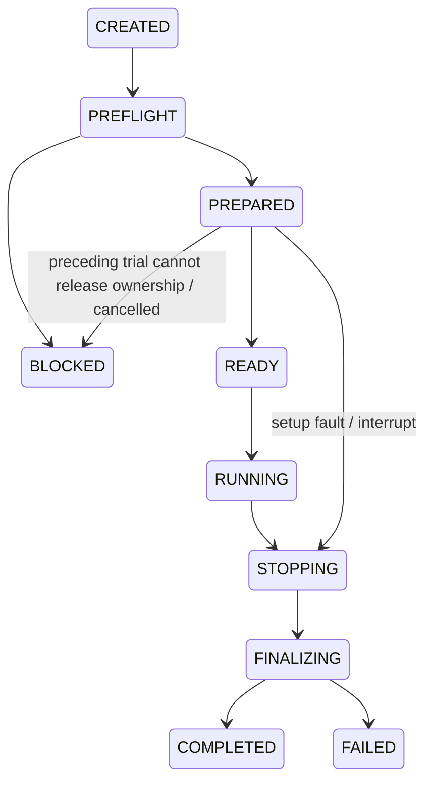

# Tasks, trial lifecycle and report summaries

The implemented Runner uses `dataset_direct` with `record_only` execution. It shares
one trial lifecycle across synchronous and paced asynchronous replay. Simulator,
device, EVA wire/console and physical scene-reset providers are still pending;
their admission fails before policy construction and retains a BLOCKED report.

## TaskSpec

`task` is optional in an experiment YAML. Without it, the task ID is the experiment
name and the allowed action type comes from the model manifest. Existing dataset
instructions are preserved. An explicit task can constrain input, timeout and evidence:

```yaml
task:
  task_id: synthetic_hold
  allowed_action_types: [joint_position]
  instruction:
    source: dataset
  timeout_s: 10.0
  reset: recorded_episode_start
  evaluator:
    source: not_measured
  required_evidence: [observations, predictions, commands, images]
```

An instruction override requires `source: override` and explicit `text`. Both the
source and effective instruction are traced. Task timeout can shorten the experiment
budget; it cannot extend it. Requiring numeric actions while `save_actions: false`,
or decoded images without `save_images: true`/full trace, fails admission.
Missing required evidence after an otherwise completed replay produces a fault.

`scene_id`, when present, is a declared label. `recorded_episode_start` resets the
dataset cursor and model episode context; it does not reset a physical scene or robot.
Native models finish their episode reset before offline READY and are not reset again
on their first prediction. Ground-truth/human/heuristic evaluator identities have a
declared schema, but recorded replay rejects causal success scoring and actuator
feedback requirements. Labels and behavior cloning errors do not judge current-policy
task success. Dataset results remain `task_success: null`, `success_source: not_measured`.

Optional model `prepare_case` and `on_trial_end` hooks are forwarded through the same
policy owner. Async hooks run on the serial model worker, with the remaining trial
budget; pending hooks prevent another trial from starting. Hook failures remain faults,
and skipped hooks remain NOT_RUN. These hooks do not reset a robot or scene.

## One Runner, one trial owner

```python
from xpolicy import ExperimentRunner

runner = ExperimentRunner("runs/mock-replay-fixture/experiment.yaml")
report = runner.evaluate()
```

Each instance evaluates once. Repeated `evaluate()` returns its saved report or
re-raises its saved error; concurrent evaluation on that instance is rejected.
Create another instance to start another experiment. `runner.stop()` is a thread-safe,
idempotent host stop request that can be called while evaluation runs in another
thread. Ctrl-C during replay also writes an interrupted result.
The CLI signal handler records this request directly, so interruption is not lost
inside Python callbacks that ignore exceptions. It restores the prior handler after evaluation.

The stop request prevents additional recording and invalidates queued actions when
the Runner/controller observes it. An in-flight vendor inference is not killed;
sync stopping waits for that call to return, while async stopping drains within the
remaining budget. A hung vendor thread can still prevent process exit, as documented
in [Chunk execution](execution.md). No device stop/hold/disengage, physical halt
latency or device ACK is inferred from this host stop request.

Only one evaluation owns the process's global model/RNG state at a time. If async
cleanup times out while inference is still running, `policy_cleanup_pending` stays
true in the retained report and the process refuses another evaluation until queued
model close actually finishes. Caller NumPy RNG state is restored at that point;
restoring it while the vendor call was live would race with that call. This gate
does not coordinate unrelated processes or user-created background RNG activity.



Every state transition and first stop reason is traced. Finalization occurs once;
terminal trials cannot resume. `lifecycle.state` describes this state machine.
The existing `status` field preserves execution outcomes (`COMPLETED`, `FAULT`,
`STOPPED`, `BLOCKED`): a completed finalization with operator stop is `STOPPED`,
and a FAILED lifecycle has `status: FAULT`. Task success is recorded separately.
Unstarted repeats remain in `not_started_trials` with NOT_RUN and their reason;
they are not manufactured as completed executions. Preflight exceptions keep their
original exception type and expose the written `report_path`.

## Results schema 2 and metrics

`results.json` includes resolved task/config/profile snapshots, source and artifact
identities, the public lock hash when available, trial transitions, stop reasons,
cleanup errors, and hashes of the trace/config/profiles/inventory/decoded-image files.
Runtime source/config/profile/lock changes during evaluation remain evidence faults.
Parsing failures before a usable config exists remain CLI/doctor configuration errors.

| Metric | Measured scope |
| --- | --- |
| Inference duration | Returned/failed local model calls, including discarded late returns when observed before controller closure |
| Queue delay | Model dispatch minus observation control tick; units are control ticks |
| Local observation age | Local decoded-observation receipt to model dispatch; not recording age or live sensor capture age |
| Local stop latency | Stop request to host scheduler stopping; no physical stop guarantee |
| CPU occupancy | Runner process user+system CPU time / trial wall time, in CPU core equivalents; optional where stdlib resource accounting is unavailable |
| Sensor age / command-to-feedback / feedback error / device halt / GPU occupancy | NOT_MEASURED with empty samples; no zero-value substitution |

Raw samples and sample counts accompany p50/p95/p99/max. Percentiles use scaled
linear interpolation, avoiding overflow for very large finite values. Pending calls
are not assigned an invented latency. CPU accounting includes the whole Runner
process, including its worker threads, and does not isolate a remote model process.
Physical task completion time, intervention count and driver watchdog results remain
unmeasured; this is not full Phase 5/6 acceptance.

## Summarize retained evidence

```bash
xpolicy results summarize \
  runs/first-run/results.json runs/second-run/results.json \
  --output runs/summary.json
```

The command accepts version 2 reports. Run older configurations again to produce
versioned evidence; version 1 reports lack the hashes required for this verification.
Evidence filenames resolve beside the input report, so complete run directories can
be moved together. Symlinks escaping that directory, changed hashes, duplicate JSON
keys, result/trace disagreement and duplicate run/trial identities are rejected.
Malformed inputs remain FAIL entries alongside valid inputs, with nonzero CLI exit.

Groups retain mode, execution settings, task, model/robot/dataset/source/package identities
and judge source. Different conditions are not averaged together. Latency quantiles
pool raw samples; trial percentiles are not averaged. Seeds, execution-started and
unstarted counts, admission failures, execution failures, judged/unjudged task counts
and explicit denominators are retained. Zero judged trials means null success rate.
FAULT/BLOCKED/STOPPED inputs keep those outcomes in the summary rather than becoming
PASS because another run completed. Integrity checks do not independently validate
the correctness of a human/heuristic/ground-truth judge or physical safety.
