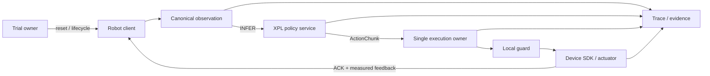

# Robot Backend 接入与验收计划
备注：方案不一定是最好方案需要实时更新完善

**状态：EVA G2 Fake ↔ XPL 策略 RPC 首轮 smoke 已 PASS；真实 G2 尚未接入或验收。**本文定义如何评估并接入一个现有 environment client 或 device backend。EVA 源仓库保持只读；实现变更放在 XPolicyLab，并只针对已确认的能力缺口。

## 目标边界

XPolicyLab 已有策略 adapter、WebSocket policy service 和外部环境 client 的接线方式。`EVAL_ENV_TYPE=real` 选择环境侧后端，不代表通用设备驱动、安全控制或真实反馈闭环已经随 XPL 提供。

| 能力 | 唯一责任方 | 接入约束 |
|---|---|---|
| Policy 加载、checkpoint、模型输入预处理 | XPL Policy Runtime | 通过现有 XPL policy RPC 服务；设备端不再加载第二份策略 |
| Trial ID、试验配置、结果与汇总 | XPL Runner 或现有 benchmark client | 选一个 owner；禁止 EVA EVAL 与 XPL Runner 为同一次试验各自编号、结束和评分 |
| 传感器读取、设备命令和厂商 SDK | 目标 environment client / DeviceBackend | 保留厂商要求的本地进程和环境；SDK 实际反馈作为真值 |
| 硬件 guard、watchdog、急停 | 设备本地安全域 | 独立于网络 RPC；XPL 超时或退出不能绕过设备安全 |
| ActionChunk 消费和时序 | 一个明确的 Execution owner | Policy adapter 与 backend 不得重复裁剪、滚动或融合同一 chunk |
| 录制与证据 | 选定的 Recorder / XPL evidence sink | `accepted`、`executed`、`measured`、`scored` 分开记录 |

若现有机器人 client 已能安全完成传感器采集、动作下发、反馈和现场评测，只需连接 XPL policy server，无需迁入 EVA。若能力缺失，则在上表中指出缺口，再只接入相应 backend 模块。

推荐的数据与控制方向如下。Trial owner 可以是现有 benchmark client，也可以是后续 XPL Runner provider；同一次试验只能选一个。



### EVA 能力到 XPL 接入点的映射

| EVA 能力候选 | XPL 侧接入点 | 验收重点 | 避免的重复实现 |
|---|---|---|---|
| Robot Zoo / `Robot` / `ActuatorGroup` | 目标 robot profile 与 DeviceBackend | 具名关节、单位、夹爪、hold 策略与实测 state | 不因向量维度相同就复用另一机器人的映射 |
| ROS/ZMQ `TransportBridge` | environment client 的传输 adapter | 序号、generation、frame/tick、编码版本、断连与 stale 命令 | 不再增加一套 policy RPC |
| Strategy / `ActionBuffer` | 唯一的 Execution owner | chunk 消费、频率、trim/overlap、reset 后旧动作失效 | 不让 Policy adapter 和执行端双重滚动 chunk |
| Recorder / Episode | 同一个 trial trace 与结果 sink | 原始传感器、模型输出、SDK 请求、ACK、反馈的关联 | 不另建 EVA `clip_id` 与 XPL `trial_id` 双状态 |
| EVA Console | 可选 Runner API/UI client | 操作权限、人工确认、状态来源和命令审计 | UI 不直接绕过 Runner/本地 safety 下发设备命令 |
| EVA Policy Zoo / EVAL / legacy policy client | 默认不接入 | 只有仍在运行的旧系统需要兼容时才测 | 不运行两份 Policy Runtime 或两套 trial owner |

## 分阶段接入与停止门

每个阶段产生独立报告。前一阶段未通过时，后一阶段只能标为 `BLOCKED` 或 `NOT_RUN`，不能用 Fake、Shadow 或其它机器人的结果覆盖。

| 阶段 | 接入工作 | 必须通过的检查 | 通过后可进入 |
|---|---|---|---|
| 0. 需求与原路径基线 | 选择目标 robot/task/client；记录 XPL 与候选 backend 的 revision、命令、解释器、lock、SDK/硬件条件；保存原 client 基线 | 不接 XPL 时原 client 能启动；边界、动作语义和安全责任有书面清单 | 进程与依赖试验 |
| 1. 进程与依赖隔离 | XPL policy server 与机器人 SDK client 分进程；保留现有 Conda/PyTorch/CUDA 栈，按已验证的 `pyproject.toml`/uv 方案管理 XPL Python 包 | 两边可独立启动、关闭；WebSocket/ROS/ZMQ 版本和环境变量有实际 inventory；启动不替换 SDK/Torch/CUDA | 协议与数据契约 |
| 2. Policy RPC | 复用 XPL WebSocket；增加或保留最薄 client adapter，不并入第二套策略 runtime | HELLO、请求/响应、RESET、超时、断连、重连、重复 request、服务重启均有报告；trial owner 唯一 | Observation/Action golden |
| 3. Observation golden | 固定相机名称/顺序、RGB、shape、dtype、frame ID、时间戳和具名 state | 同一帧经现有 client 与新 adapter 后，公共 Observation 逐字段匹配；缺相机、陈旧帧、乱序帧按配置拒绝 | Action 映射 |
| 4. Action golden | 明确具名关节、单位、语义、归一化来源、夹爪转换、inactive group 策略和有效时间 | 固定输入下，Policy 输出到 backend 命令映射逐字段匹配 golden；缺字段、错序、越界、非有限值、未知单位 fail-closed | 执行时序 |
| 5. Execution / Fault injection | 选择 sync 或 async 模式，明确 chunk 消费者、控制频率、trim/overlap、generation 和 stop owner | Reset 后旧 generation 不下发；重复/过期/乱序命令被拒；延迟、RPC 丢失、模型挂起、buffer 空和 SDK 错误可恢复或进入 FAULT | Fake / SDK Mock |
| 6. Fake Plant / SDK Mock | 对真实 node 核心逻辑做依赖注入；Fake 只测试声明的动力学和命令路径 | 命令次数、具名 SDK 参数、反馈、reset、stop、错误码均可断言；相机合成图不作为真实视觉能力证据 | Real Shadow |
| 7. Real Shadow | 连接真机只读传感器；设备端没有或无权调用伺服 API | 设备调用计数为 0；观测健康、映射和状态差异符合阈值；日志证明没有动作副作用 | 受控动作评审 |
| 8. 受控真机 | 现场安全人员确认，设备本地 guard/E-stop 可用；按批准顺序先做单关节低速小幅运动，再扩大范围 | 命令方向/单位与实测反馈一致；未控关节保持；失联、stop、重连和故障恢复满足厂商/现场批准的时限；每次明确人工 re-arm | 目标任务验收 |
| 9. 任务与回归 | 冻结模型、checkpoint、dataset、配置、任务和随机种子；同原 client 比较 | 任务判分来源、成功/失败、延迟分布和异常样本完整；不能只以模型返回动作或 RPC `accepted` 记成功 | 发布/扩展 |

阶段 8 的运动范围、速度、关节限位、停止时限必须取自设备厂商和现场批准值；未确认前不填入猜测常数，也不运行自动运动测试。

## 回归用例

下列用例将已有蓝图 A–F 要求落到 backend 接入边界。实际运行时应记录 fixture、源 revision 和逐项结果，而不是把整个阶段只报一个 PASS。

### P. 进程、协议与环境

- **P01**：XPL policy server 与设备 client 分别启动；记录解释器路径、Python/OS/libc、包版本、CUDA/SDK 身份。
- **P02**：按现有 Conda 环境运行设备 SDK；公共 Python 包由项目声明和 uv 管理，任何共享解释器方案先做 dependency diff，不静默升级 Torch、CUDA、ROS 或厂商 SDK。
- **P03**：HELLO/握手字段、`request_id`、超时、同请求重试、断连重连、server restart 和 RESET 均覆盖成功与失败路径。
- **P04**：两端时钟域、采样时间、frame ID 和 control tick 不混用；不以 RPC 接收时间伪造采样或执行时间。
- **P05**：若候选 client 使用与 XPL 不兼容的 WebSocket/消息栈，保持进程隔离并用真实 loopback/network 回归；不得只因依赖冲突就复制第二套 policy RPC。

### O. Observation 与模型输入

- **O01**：逐相机验证名称、左右顺序、分辨率、通道数、RGB、uint8、时间戳和有效位。
- **O02**：原始数据与 XPL decoder 产物通过 golden 像素检查；存储图像只经共享 `decode_image_bit`，测试覆盖 legacy 与 marker JPEG。
- **O03**：原始具名 qpos/qvel、单位、关节顺序、缺测标志、归一化前后 dtype 与最终模型输入分开保存。
- **O04**：丢相机、冻结帧、乱序帧、时间倒退、NaN/Inf、state 长度变化分别注入；每个错误应在首个边界拒绝或显式标为 degraded。
- **O05**：训练 loader 和部署路径固定同一原始 Observation 后，对照模型实际收到的图像/state tensor；固定 resize、crop、增强、归一化、量化和容差。

### A. Action 与 Execution

- **A01**：检查 action 字段名、顺序、单位、绝对/增量语义、参考坐标系、夹爪语义、归一化及反归一化调用次数。
- **A02**：将每个策略维度映射到具名目标关节；重复映射、漏映射、未知关节和未经批准的 inactive group 都必须 fail-closed。
- **A03**：用冻结 `[T,D]` chunk 验证只有一个消费者；记录模型 forward 次数、实际下发步数、chunk 索引和每步贡献来源。
- **A04**：控制频率、chunk horizon、latency trim、overlap、命令有效期和停止语义使用固定 golden 输入；严禁在 adapter 与设备端重复消费。
- **A05**：RESET/stop/重连/新 episode 后递增 generation；旧 generation、过期、重复、乱序和超范围动作不进入 SDK 调用。
- **A06**：记录 policy output、mapper output、SDK request、SDK ACK、实测反馈五个独立阶段；只有 measured feedback 能证明设备执行。

### F. Fake 与 SDK Mock

- **F01**：对真实机器人节点的核心调用路径依赖注入 SDK Mock，不复制一份行为不明的测试实现。
- **F02**：Mock 断言方法、参数名、单位、关节名、命令频率和线程归属；覆盖成功、拒绝、超时、异常和部分返回。
- **F03**：注入断流、慢响应、重复消息、过期命令、缓冲区满、模型无响应、录像磁盘满、进程退出和 stop 失败。
- **F04**：Fake Plant 报告只声明经过实现的因果状态；若合成图与动作无关，禁止用它验收视觉策略。
- **F05**：每个 fault 断言最终状态、SDK 调用次数、残留队列、资源关闭和是否需要 re-arm；出现无法确认的设备状态时进入 FAULT。

### S. Shadow 与受控真机

- **S01**：Shadow backend 在接口或权限层禁用 servo；用 spy/mock 和设备侧日志两处证明伺服调用次数均为 0。
- **S02**：Shadow 记录从 sensor frame 到候选 action 的完整 trace，但不将候选 action 反馈成 qpos，也不报告任务成功。
- **S03**：实机前现场复核 E-stop、限位、动作映射、人员位置、场景复位、设备 watchdog 和通信断开行为。
- **S04**：受控测试每次只改变已批准的变量；保存人工签字、设备日志、命令/测量曲线和恢复状态。
- **S05**：任何 E-stop 不可用、映射不明、测量缺失、停止无 ACK、运动方向异常或旧命令复现都立即停止该阶段并保留 FAIL/BLOCKED 证据。

## 每阶段报告与准入规则

报告至少包含：XPL commit、候选 backend revision、源文件哈希、配置与 profile 哈希、dataset/checkpoint 身份、解释器与依赖 inventory、设备/SDK 型号和版本、seed、测试命令、完整日志、fault 注入、逐项状态、首次失败边界和未执行项。结果只用 `PASS`、`FAIL`、`BLOCKED`、`NOT_RUN`；安全用例不能通过跳过变成 PASS。

准入顺序是 `P → O → A → F → S-Shadow → S-Controlled`。T0–T5 可由 CI、mock 或模拟器覆盖；Shadow 需要真实只读传感器；受控真机需要现场人员和独立安全许可。CI 绿灯不等于真机通过，单个机器人的通过也不推广到其它型号。

## 当前状态

XPL 已有的策略/RPC、Runner 记录回放、Fault/Report 基础分别见 [环境 provider 状态](environments.md) 与[迁移验收状态](migration-status.md)。通用 EVA environment provider、SDK Mock、Shadow 和 Real provider 仍未实现；下面仅记录一个范围受限的 G2 Fake loopback harness，不将其注册成可供通用 Runner 使用的 environment provider。

### 首轮 G2 Fake ↔ XPL 对齐证据（2026-10-19）

- EVA 源目录 `/data/tzq/EVA-CLIENT-main` 是无 `.git` 元数据的本地源码快照；报告保存了关键源码 SHA256。源目录没有被修改。
- 通过 `conda create -n XPolicyLab-EVA-G2 --clone sam2_measure` 保留 Python 3.11、Torch 2.5.1+cu124 与 NumPy 1.26.4；用 `uv pip install --python <cloned-python> -e '.[dev]'` 从 EVA `pyproject.toml` 安装，未安装 GDK。XPL policy service / bridge 留在原 XPL 环境，使用 `uv pip install --python <xpl-python> -e '.[eva-g2]'` 安装其可选 RPC/ZMQ bridge 依赖。
- 纯 Fake 回归：`conda run -n XPolicyLab-EVA-G2 python -m pytest -q tests/hardware/test_fake_common.py` → **18 passed**。
- XPL 合约、RPC、provider 与 G2 wire 回归：`conda run -n XPolicyLab python -m pytest -q tests/test_eva_g2_integration.py tests/test_environment_provider.py tests/test_policy_rpc.py tests/test_core_contracts.py` → **71 passed**。
- 三进程 loopback 命令（XPL 策略服务、XPL bridge、EVA Fake G2）通过 30 个观察、30 次策略推理、29 个 fake 动作。具名 24D mock hold action 与其来源 Observation 的状态逐元素相同；相机按声明源键映射，RGB 数据原样传递。`report.json` 和逐帧 trace 位于忽略目录 `runs/eva-g2-fake/<run_id>/`。

复现命令：

```bash
conda run -n XPolicyLab python -m xpolicy integration eva-g2-fake \
  --eva-root /path/to/EVA-CLIENT-main \
  --eva-python /path/to/conda/envs/XPolicyLab-EVA-G2/bin/python \
  --frames 30
```

此 PASS 只覆盖本机 Fake 进程、loopback ZMQ、XPL WebSocket policy RPC、Observation 映射与 mock hold action 线缆映射，不代表动作产生了因果移动或任务成功。Fake profile `agibot_g2_eva_fake_v1` 使用 EVA Robot Zoo 的外侧夹爪关节名；真实 `node.py` 使用内侧夹爪关节名。真实 node 还通过 OpenCV 解码相机数据为 BGR，而 XPL 边界要求 RGB。两项都未得到可用于实机的映射/色序证据，因此 real GDK、physical units/calibration、device-local watchdog、stop acknowledgement、Shadow 与任务成功均为 **NOT_RUN**，不得把此 profile 或 harness 指向设备。

P/O/A/F/S 逐项验收仍按前面的阶段门执行；本次 loopback 没有跳过真机前置条件，也没有把 Fake 结果升级成硬件通过。
